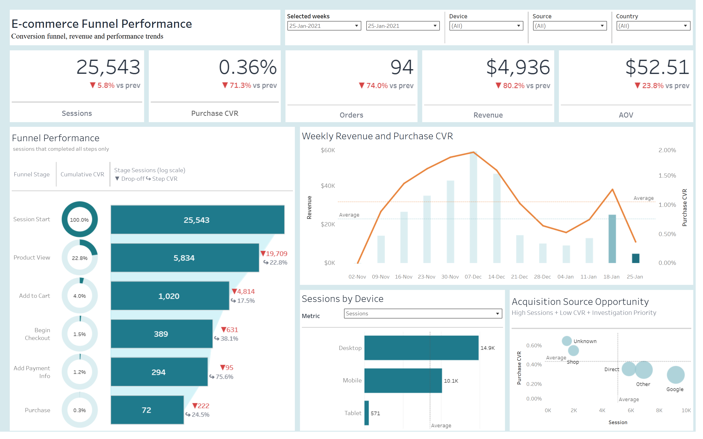

# E-commerce Funnel Performance

[English](README.md) · **Українська**

**Інтерактивний дашборд:** [Tableau Public](https://public.tableau.com/views/EcommerceFunnelPerformance/E-commerceFunnelPerfomance)

Аналіз воронки конверсії інтернет-магазину: де втрачаються користувачі, що спричинило різке падіння виручки наприкінці періоду і які канали трафіку працюють найефективніше.

| | |
|---|---|
| **Інструменти** | Tableau, SQL (BigQuery) |
| **Дані** | Google Analytics 4, Google Merchandise Store (публічний обфускований датасет GA4) |
| **Період** | 2 листопада 2020 – 25 січня 2021 (13 тижнів) |
| **Виміри** | тиждень, пристрій, країна, джерело трафіку, етап воронки |

## Можливості дашборду

- **KPI з порівнянням з попереднім періодом:** Sessions, Purchase CVR, Orders, Revenue, AOV.
- **Вибір періоду:** один тиждень або кілька тижнів поспіль. Порівняння йде з попереднім періодом такої самої довжини. Період можна вибрати у фільтрах або виділити стовпчики на графіку тренду.
- **Воронка з 6 етапів** (Session Start → Product View → Add to Cart → Begin Checkout → Add Payment Info → Purchase) з кумулятивною та покроковою конверсією.
- **Тренд виручки й Purchase CVR** з підсвіткою обраного й попереднього періодів.
- **Розрізи** за пристроєм (з перемиканням метрики) та джерелом трафіку.
- **Фільтри:** Device, Source, Country.

## Примітки щодо даних та обмеження аналізу

- **Особливості розрахунку воронки.** Воронка враховує сесії, що послідовно пройшли всі визначені етапи. KPI Orders і Purchase CVR охоплюють також покупки, здійснені без проходження всіх етапів воронки. Тому кількість покупок на етапі Purchase може відрізнятися від значення Orders.
- **Неповний трекінг на початку періоду.** У перші тижні спостерігаються аномалії в реєстрації подій: 2 листопада не зафіксовано Add to Cart і покупок, 9 листопада — Add to Cart, а 16 листопада його частка становила лише 8% від переглядів товарів. Повноту трекінгу необхідно враховувати під час порівняння тижнів; повноцінний аналіз динаміки доцільно проводити з кінця листопада.

---

## 1. Ключові висновки

Аналіз воронки продажів виявив три основні проблеми: різке падіння виручки наприкінці періоду, значні втрати користувачів на початкових етапах воронки та поступове зниження конверсії переглядів товарів у додавання до кошика.

- **Критичне падіння виручки 25 січня.** Виручка скоротилася на 80% — з $24,9 тис. до $4,9 тис., тоді як кількість сесій зменшилася лише на 6%. Основне погіршення відбулося на етапі Add Payment Info → Purchase, що може свідчити про технічну проблему з оплатою або реєстрацією покупок у GA4.
- **Найбільші втрати — на початку воронки.** Лише 21,2% сесій досягали етапу перегляду товару. Це вказує на необхідність перевірити навігацію сайту, релевантність посадкових сторінок і коректність збору подій.
- **Конверсія перегляду товару в додавання до кошика знижується.** Показник скоротився з 33,7% наприкінці листопада до 17,5% 25 січня. Це може бути пов'язано зі змінами в попиті, асортименті, цінах або користувацькому досвіді.
- **Google залучає значний обсяг трафіку, але поступається за ефективністю.** На джерело припадає близько третини сесій, однак його частка у виручці нижча. Основне відставання спостерігається на етапі переходу від перегляду товару до додавання в кошик.
- **Джерело Unknown демонструє найвищу конверсію.** Водночас відсутність чіткої атрибуції не дає змоги визначити, які саме кампанії чи канали забезпечують цей результат.

Головний пріоритет — перевірити коректність трекінгу та причини падіння конверсії наприкінці січня, а також паралельно дослідити втрати на початку воронки й погіршення показників на етапі Add to Cart.

---

## 2. Критичне падіння показників 25 січня 2021 року

Порівняння двох останніх тижнів виявило різке погіршення комерційних результатів за відносно стабільного обсягу трафіку.

| Метрика | 18-Jan | 25-Jan | Зміна |
|---|---|---|---|
| Sessions | 27 120 | 25 543 | −6% |
| Purchase CVR | 1.27% | 0.36% | −71% |
| Orders | 362 | 94 | −74% |
| Revenue | $24 947 | $4 936 | −80% |
| AOV | $68.91 | $52.51 | −24% |

Падіння виручки значно перевищує скорочення трафіку. Отже, основна проблема полягає не в кількості відвідувачів, а в ефективності їх конвертації в покупки та зменшенні середнього чека.

### Аналіз етапів воронки

| Етап | Типовий рівень в інші тижні | 25 січня | Оцінка |
|---|---|---|---|
| Session Start → Product View | 15–25% | 22.8% | У межах типового діапазону |
| Product View → Add to Cart | 19–34% | 17.5% | Нижче типового діапазону |
| Add to Cart → Begin Checkout | 25–41% | 38.1% | У межах типового діапазону |
| Begin Checkout → Add Payment Info | 63–79% | 75.6% | У межах типового діапазону |
| **Add Payment Info → Purchase** | **64–74%** | **24.5%** | **Критичне відхилення** |

Найбільш різке погіршення спостерігається на останньому етапі: частка користувачів, які здійснюють покупку після введення платіжної інформації. Конверсія Add Payment Info → Purchase знизилась до 24,5%, тоді як в інші тижні вона переважно перебувала в діапазоні 64–74%.

Проблема проявляється в усіх проаналізованих сегментах:

- **Пристрої:** Desktop — 23.2% · Mobile — 25.8% · Tablet — 28.6%
- **Джерела:** Unknown — 20.5% · Google — 22.5% · Direct — 23.7% · Shop — 27.0% · Other — 28.8%
- **Країни:** Canada — 15.8% · Spain — 25.0% · India — 27.3% · USA — 27.6%

Схожий характер відхилення в різних сегментах підсилює гіпотезу про системну проблему, а не про локальне погіршення якості трафіку.

### Можливі причини

1. **Збій платіжного процесу:** помилки платіжного шлюзу, відхилення транзакцій або проблеми зі сторінкою підтвердження замовлення.
2. **Порушення трекінгу GA4:** подія `purchase` перестала реєструватися або передаватися коректно після оновлення сайту.
3. **Неповнота даних:** останній тиждень може містити неповний період спостереження або затримку надходження подій.

Щоб визначити причину падіння, потрібно перевірити дані GA4, замовлення, логи платіжної системи та останні оновлення сайту.

---

## 3. Сезонність і динаміка попиту

Найвищі результати зафіксовано в тиждень 7 грудня: виручка становила $57,8 тис., а Purchase CVR досягав 1,91%.

Після цього спостерігалося поступове зниження комерційних показників, яке тривало до початку січня. Виручка скоротилася до $9,2 тис. у тиждень 4 січня.

Імовірне пояснення — сезонність попиту: завершення періоду Black Friday та Cyber Monday, а згодом і основної хвилі святкових покупок. Водночас сезонність є гіпотезою, яку варто перевірити за історичними даними та динамікою попиту.

### Аномалія 4 січня

У цей тиждень кількість сесій зросла на 42% порівняно з попереднім періодом, але Purchase CVR знизився до 0,53%. При цьому до перегляду товарів доходили лише близько 15% відвідувачів.

Поєднання зростання трафіку зі зниженням залученості та конверсії може свідчити про зміну структури аудиторії, збільшення частки нецільових відвідувань або проблеми з трекінгом.

**Рекомендація:** перевірити джерела приросту трафіку, посадкові сторінки та поведінку користувачів у цей період.

---

## 4. Найбільша втрата у воронці: Session Start → Product View

За весь період до етапу перегляду товару дійшли лише 74 736 із 352 263 сесій — приблизно 21,2%. Відповідно, близько 79% сесій не містили зафіксованого переходу до цього етапу.

Це найбільша втрата за абсолютною кількістю сесій. Разом з тим слід перевірити, як саме налаштовано подію `view_item` і логіку побудови воронки.

### Результати за сегментами

| Вимір | Сегмент | Session → Product View |
|---|---|---|
| **Усього** | | **21.2%** |
| Device | Desktop | 21.3% |
| | Mobile | 21.1% |
| | Tablet | 21.0% |
| Source | Unknown | 25.0% |
| | Shop | 22.8% |
| | Direct | 21.0% |
| | Google | 20.8% |
| | Other | 20.7% |
| Country | Канада | 21.7% |
| | Індія | 21.3% |
| | США | 21.2% |
| | Франція | 20.7% |
| | Іспанія | 20.6% |

Показники майже не відрізняються між пристроями та країнами. Це підсилює припущення, що проблему слід шукати на рівні загального користувацького шляху або вимірювання подій.

### Можливі причини

- **Проблеми навігації:** головна сторінка, категорії або пошук недостатньо ефективно спрямовують користувачів до товарів.
- **Невідповідність посадкових сторінок очікуванням:** відвідувачі потрапляють на сторінки, які не відповідають їхньому пошуковому запиту чи наміру.
- **Неповний збір подій:** `view_item` може спрацьовувати не на всіх релевантних сторінках або некоректно передаватися в GA4.
- **Особливості визначення воронки:** частина користувачів може взаємодіяти з магазином, не проходячи всі етапи в заданій послідовності.

### Рекомендовані дії

1. Перевірити налаштування події `view_item` через DebugView і GTM Preview.
2. Зіставити посадкові сторінки, кількість сесій і переходи до карток товарів.
3. Проаналізувати показники залученості, виходів і переходів у розрізі типу сторінки.
4. Перевірити навігацію, внутрішній пошук, видимість товарів, цін і кнопок переходу до покупки.

Перш ніж оптимізувати сайт, необхідно підтвердити, що він коректно відображає поведінку користувачів.

---

## 5. Зниження конверсії Product View → Add to Cart

Наприкінці листопада конверсія переглядів товарів у додавання до кошика становила 33,7%. До 25 січня вона знизилася до 17,5%, тобто майже вдвічі.

| Тиждень | 30.11 | 07.12 | 14.12 | 21.12 | 28.12 | 04.01 | 11.01 | 18.01 | 25.01 |
|---|---|---|---|---|---|---|---|---|---|
| Product View → Add to Cart | 33.7% | 33.3% | 29.7% | 24.0% | 21.0% | 21.6% | 22.4% | 18.6% | 17.5% |

Основна тенденція — поступове погіршення показника після грудневого піку. На початку січня показник стабілізувався на рівні 21–22%, але з 18 січня знову знизився.

Навіть після відновлення загальної конверсії покупок 18 січня ефективність додавання товарів до кошика залишалася нижчою за грудневі значення.

### Що необхідно перевірити

- зміни цін і асортименту;
- наявність популярних товарів і розмірів;
- якість карток товарів, фотографій та описів;
- помітність і працездатність кнопки Add to Cart;
- вартість і умови доставки;
- технічну коректність подій `view_item` та `add_to_cart`.

**Ціль оптимізації:** утримувати Product View → Add to Cart не нижче медіани 22.0% періоду з повним трекінгом (23.11.2020 – 25.01.2021).

---

## 6. Ефективність джерел трафіку

Для порівняння джерел використано період із повним трекінгом — 23 листопада 2020 року – 25 січня 2021 року.

| Джерело | Частка сесій | Purchase CVR | AOV | Revenue per Session |
|---|---|---|---|---|
| Google | 36.1% | 1.01% | $70.0 | $0.76 |
| Direct | 23.2% | 1.13% | $70.6 | $0.88 |
| Other | 27.4% | 0.99% | $67.1 | $0.75 |
| Shop | 7.7% | 1.88% | $72.0 | $1.56 |
| Unknown | 5.6% | 3.03% | $60.2 | $2.09 |

### Основні спостереження

**Google — значний обсяг трафіку, але нижча ефективність монетизації.** Purchase CVR становить 1,01%, а виручка на сесію — $0,76. Для порівняння, Shop забезпечує CVR 1,88% і $1,56 виручки на сесію, а Unknown — CVR 3,03% і $2,09 виручки на сесію. Це не означає автоматично, що трафік Google є збитковим: для такого висновку потрібні дані про рекламні витрати, маржу та вартість залучення клієнта.

**Shop — перспективне джерело для масштабування.** Високі CVR і виручка на сесію свідчать про потенційно вищу комерційну цінність цього каналу. Варто дослідити його структуру та перевірити, чи можна збільшити обсяг трафіку без суттєвого погіршення якості.

**Unknown — найвищі показники, але невизначена атрибуція.** Джерело демонструє найвищу конверсію та виручку на сесію. Однак без деталізації каналів неможливо визначити, які саме маркетингові активності забезпечують цей результат.

### На якому етапі Google втрачає користувачів

| Етап | Google | Direct | Unknown | Shop | Other |
|---|---|---|---|---|---|
| Session Start → Product View | 19.9% | 20.3% | 25.1% | 22.2% | 19.9% |
| Product View → Add to Cart | 23.3% | 25.3% | 34.2% | 28.4% | 23.9% |
| Add to Cart → Checkout | 33.4% | 35.5% | 44.5% | 39.9% | 33.7% |
| Begin Checkout → Payment | 69.8% | 70.3% | 81.8% | 77.2% | 66.8% |
| Payment → Purchase | 66.5% | 65.2% | 67.5% | 70.0% | 67.2% |

Основне відставання Google спостерігається на початкових етапах, передусім під час переходу від перегляду товару до додавання в кошик. На фінальному етапі конверсія близька до показників інших джерел.

Це може свідчити про нижчу відповідність між наміром користувачів, їхніми пошуковими запитами та асортиментом магазину. Наприклад, частина аудиторії може шукати інформацію про бренд Google або його електроніку, а потрапляти до магазину мерчу.

### Рекомендації для Google

1. Проаналізувати пошукові запити, типи кампаній і посадкові сторінки.
2. Відокремити інформаційні запити від запитів із комерційним наміром.
3. Перевірити відповідність рекламних оголошень асортименту Google Merchandise Store.
4. Спрямовувати користувачів на релевантні картки товарів із чіткою ціною, описом і кнопкою додавання до кошика.
5. Оцінювати ефективність за виручкою на сесію, ROAS і маржинальним прибутком, а не лише за обсягом трафіку.

---

## 7. Пріоритетний план дій

| Пріоритет | Завдання | Очікуваний результат |
|---|---|---|
| Високий | Проаналізувати тиждень 25 січня в розрізі днів; зіставити GA4, фактичні замовлення, логи платіжного провайдера та релізи сайту | Встановити причину падіння виручки на 80% |
| Високий | Перевірити події `purchase`, `add_payment_info`, `view_item`, `add_to_cart` | Підтвердити коректність вимірювання воронки |
| Високий | Налаштувати щоденний моніторинг конверсії Payment Info → Purchase та сповіщення про аномалії | Скоротити час виявлення технічних збоїв |
| Високий | Дослідити причини зниження Product View → Add to Cart з 33,7% до 17,5% | Виявити бар'єри перед додаванням товару до кошика |
| Високий | Перевірити UTM-мітки та визначити джерела трафіку, що потрапляють до Unknown | Поліпшити атрибуцію та оцінювання ефективності каналів |
| Середній | Проаналізувати пошукові запити Google і відповідність посадкових сторінок намірам аудиторії | Підвищити якість трафіку та виручку на сесію |
| Середній | Запустити ремаркетинг на користувачів, які переглядали товари, але не додали їх до кошика | Повернути зацікавлених користувачів і збільшити кількість покупок |

### Рекомендації щодо моніторингу

Для контролю воронки варто налаштувати щоденний моніторинг таких показників:

- Purchase CVR;
- Revenue та Orders;
- Add Payment Info → Purchase;
- Product View → Add to Cart;
- частка сесій із подією `view_item`;
- частка трафіку з невизначеним джерелом.

Для критичного кроку Payment Info → Purchase можна встановити попередній поріг сповіщення нижче 50%. Водночас поріг слід уточнити на основі історичних даних, денного обсягу подій і статистичної варіативності, щоб уникнути надмірної кількості хибних сповіщень.

---

## 8. Підсумок

Аналіз показує, що ефективність e-commerce-воронки обмежують щонайменше три різні чинники: втрати користувачів на початковому етапі, зниження зацікавленості товарами та аномальне падіння конверсії в покупку наприкінці періоду.

Насамперед необхідно перевірити технічну коректність даних за 25 січня та встановити, чи відображає падіння Purchase CVR реальне погіршення процесу оплати, чи є наслідком проблем із трекінгом. Паралельно слід дослідити причини низької частки сесій із переглядом товарів і поступового зниження Add to Cart.

У маркетинговому напрямі пріоритетами є покращення атрибуції Unknown, аналіз якості трафіку Google та оцінювання потенціалу масштабування Shop.

**Очікуваний результат:** більш надійна аналітика, швидше виявлення технічних проблем, підвищення конверсії на ключових етапах воронки та ефективніше використання маркетингового бюджету.
